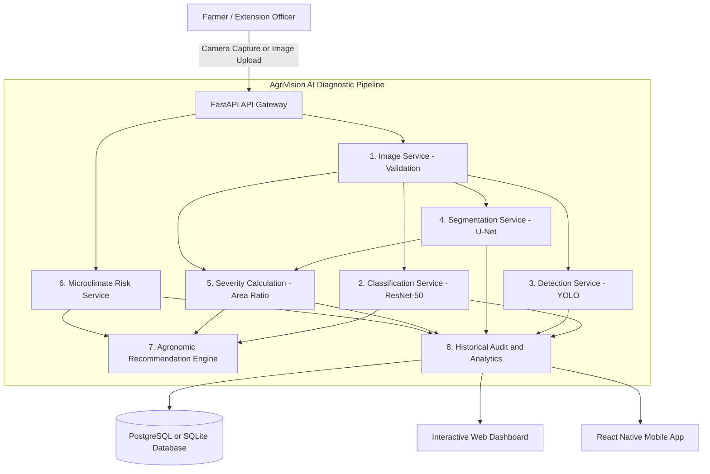

# 🌱 AgriVision AI — Intelligent Crop Diagnostic & Health Platform

[](https://fastapi.tiangolo.com)
[](https://pytorch.org)
[](https://ultralytics.com)
[](https://docker.com)
[](https://github.com/Gokulraj-max/AgriVision)

AgriVision AI is an enterprise-grade precision agriculture and foliar disease diagnosis platform. It enables farmers, agronomists, and agricultural extension officers to upload crop leaf imagery or stream live camera feeds alongside microclimate telemetry to receive instant, multi-model crop pathology diagnostics and validated agronomic guidance.

---

## 🌟 Key Features

| Capability | Component / Architecture | Description |
| :--- | :--- | :--- |
| **📹 Live Camera Recognition** | HTML5 MediaDevices + WebRTC Video | Real-time live camera viewfinder with alignment reticle, camera switcher, and instant auto-recognition upon capture. |
| **🔬 Disease Classification** | PyTorch ResNet-50 / Leaf CNN | 10 PlantVillage tomato disease categories with confidence scores and top differential diagnoses. |
| **📦 Symptom Defect Detection**| Ultralytics YOLO / Morphology | Localizes defect areas with precise bounding boxes `[ymin, xmin, ymax, xmax]`, labels, and confidence. |
| **⬛ Pixel-Level Lesion Mask** | PyTorch U-Net (Dice + BCE) | Pixel-accurate lesion segmentation separating green canopy from necrotic tissue with heatmap overlays. |
| **📐 Foliar Severity Estimation** | CV Pixel Surface Ratio Math | Affected area surface ratio $\frac{\text{Affected Pixels}}{\text{Leaf Pixels}} \times 100$, classified into Severity Grades (Healthy to Severe). |
| **⛅ Weather Risk Forecasting**| Random Forest + NASA POWER API | Disease risk index (0–100%) computed from temperature, relative humidity, and 24h precipitation favorability windows. |
| **🌾 Agronomic Guidance** | Validated IPM Recommendation Engine | Immediate cultural sanitation actions, preventative practices, and chemical regulatory warnings. |
| **📦 High-Throughput Batch Scouting**| Concurrent Async Pipeline | Multi-file concurrent processing for scouting large crop fields with CSV/JSON exports. |
| **📊 Farm Analytics & Audit Trail** | SQLAlchemy ORM + SQLite/PostgreSQL | Historical records, longitudinal health trends, and disease prevalence breakdowns per agricultural block. |
| **📱 Mobile Field Application** | React Native + Expo + MobileNetV3 | Offline-first mobile field companion with on-device camera scanner and SQLite caching. |

---

## 🏗️ Architecture Overview



---

## 📁 Repository Structure

```text
AgriVision/
├── agrivision/                  # Core FastAPI Application & Web Studio
│   ├── api/                     # REST API route handlers
│   │   ├── routes_inspection.py # Multi-model diagnosis endpoint (/inspect)
│   │   ├── routes_farm.py       # Farm entities and analytics
│   │   ├── routes_weather.py    # NASA POWER & risk assessment
│   │   ├── routes_models.py     # Model registry & benchmarks
│   │   ├── routes_samples.py    # Sample specimen gallery
│   │   └── routes_feedback.py   # Expert review & human-in-the-loop
│   ├── database/                # SQLAlchemy database session & ORM models
│   ├── models/                  # PyTorch model definitions (ResNet, U-Net, RF)
│   ├── services/                # Business logic & inference services
│   ├── static/                  # Web dashboard UI assets
│   │   ├── css/styles.css       # Responsive dark-theme agronomy stylesheet
│   │   ├── js/app.js            # Client-side app & Live Camera controller
│   │   └── index.html           # Diagnostic Studio dashboard
│   ├── config.py                # App configuration, disease classes & paths
│   └── main.py                  # FastAPI entry point & lifespan manager
├── backend/                     # Extended microservices (Assistant, Voice, Auth)
├── mobile/                      # React Native / Expo Mobile Application
│   ├── app/                     # Expo router screens (scanner, farms, assistant)
│   ├── assets/models/           # On-device MobileNetV3 weights (.pt/.pth)
│   └── package.json             # Mobile dependencies
├── samples/                     # Built-in reference crop specimens
├── scripts/                     # Training, synthetic generation & eval scripts
│   ├── generate_synthetic_samples.py
│   ├── train_weather_model.py
│   ├── train_classifier.py
│   ├── train_unet.py
│   └── evaluate_pipeline.py
├── weights/                     # Pretrained model weights (weather_risk_rf.pkl)
├── tests/                       # Automated pytest test suites
├── Dockerfile                   # Production Docker container definition
├── docker-compose.yml           # Multi-container orchestration (Web, DB, Redis)
├── render.yaml                  # Render cloud blueprint
├── Procfile                     # Heroku / Koyeb process definition
├── requirements.txt             # Python dependencies
├── start.bat                    # Windows 1-click startup batch script
└── start.ps1                    # PowerShell startup script
```

---

## ⚡ Quick Start (Local Run)

### Prerequisites
* Python 3.10+ installed
* Webcam or smartphone camera (for live recognition)

### 1. Clone the Repository
```bash
git clone https://github.com/Gokulraj-max/AgriVision.git
cd AgriVision
```

### 2. Install Dependencies
```bash
pip install -r requirements.txt
```

### 3. Initialize Specimen Samples & Weights
```bash
python scripts/generate_synthetic_samples.py
python scripts/train_weather_model.py
```

### 4. Launch the Server
**Using the provided scripts:**
* **Windows (PowerShell):** `.\start.ps1`
* **Windows (Command Prompt):** `start.bat`

**Or direct command:**
```bash
python -m uvicorn agrivision.main:app --host 127.0.0.1 --port 8000 --reload
```

Open your browser at:
* 🖥️ **Interactive Web Dashboard:** [http://127.0.0.1:8000](http://127.0.0.1:8000)
* 📜 **Swagger OpenAPI Docs:** [http://127.0.0.1:8000/docs](http://127.0.0.1:8000/docs)
* 📖 **ReDoc Documentation:** [http://127.0.0.1:8000/redoc](http://127.0.0.1:8000/redoc)

---

## 📹 Using the Live Camera Feature

1. Navigate to **Diagnostic Studio** on the dashboard.
2. In the **Crop Leaf Specimen** card, click the **📹 Live Camera** tab (or **📷 Open Live Camera**).
3. Allow browser camera permissions.
4. Align the leaf specimen inside the bounding reticle (*"🌿 Center leaf inside frame"*).
5. (Optional) Use **🔄 Switch** to toggle between front/back or external USB webcams.
6. Click **📸 Capture & Recognize**:
   * The frame is grabbed at full resolution.
   * The camera is automatically released.
   * The **5-engine AI diagnostic pipeline executes immediately**, presenting the classification, bounding boxes, segmentation masks, severity score, and agronomic actions in real time!

---

## 🚀 Cloud Deployment Guide

The repository includes pre-configured deployment manifests:

### Option 1: Deploy on Render (1-Click Blueprint)
1. Sign in to [Render](https://render.com) using your GitHub account.
2. Click **New +** > **Blueprint**.
3. Select your `AgriVision` repository.
4. Render will read `render.yaml`, configure the Docker runtime, build dependencies, and launch your live application with a public HTTPS URL.

### Option 2: Deploy on Railway
1. Sign in to [Railway](https://railway.app).
2. Click **New Project** > **Deploy from GitHub repo**.
3. Select `Gokulraj-max/AgriVision`.
4. Railway will automatically detect the `Dockerfile`, build the container, and provide a live URL.

### Option 3: Deploy with Docker Compose (Local / Server)
```bash
docker-compose up --build
```
This boots:
* **FastAPI Web Service:** `http://localhost:8000`
* **PostgreSQL Database:** `localhost:5432`
* **Redis Cache:** `localhost:6379`

---

## 📡 REST API Reference

| Method | Endpoint | Description |
| :--- | :--- | :--- |
| `POST` | `/api/v1/inspect` | End-to-end diagnostic pipeline (Classification, YOLO, U-Net, Severity, Weather Risk). |
| `GET` | `/api/v1/farms` | List registered farm entities and metadata. |
| `POST` | `/api/v1/farms` | Register a new agricultural farm/block. |
| `GET` | `/api/v1/farms/{id}/health` | Retrieve farm health metrics, disease breakdown, and score. |
| `GET` | `/api/v1/weather/risk` | Calculate disease favorability risk from temperature, humidity, rainfall. |
| `GET` | `/api/v1/weather/nasa` | Auto-fetch real-world meteorological telemetry by GPS coordinates. |
| `GET` | `/api/v1/samples` | List instant 1-click test specimen presets. |
| `GET` | `/api/v1/models` | List active AI model registry and evaluation benchmark scores. |
| `POST` | `/api/v1/feedback` | Submit expert review or agronomist diagnostic override. |
| `GET` | `/health` | Service health status check. |

---

## 📱 Mobile App (React Native & Expo)

The `mobile/` directory contains an offline-first companion application for field agronomists:

```bash
cd mobile
npm install
npx expo start
```
* **Offline Inference:** Runs PyTorch MobileNetV3 directly on the device using PyTorch Mobile.
* **Camera Scanner:** Built with `react-native-vision-camera` and `expo-camera`.
* **Syncing:** Synchronizes inspections with the backend API when connectivity is restored.

---

## 🧪 Testing & Model Evaluation

Run automated unit and integration tests:
```bash
pytest tests/ -v
```

Run the multi-model benchmark evaluation suite:
```bash
python scripts/evaluate_pipeline.py
```

---

## 🛡️ Agricultural Safety & Regulatory Notice

> **Important Agricultural Disclaimer:**  
> AgriVision AI is designed as a precision decision-support system to assist farmers and agronomists; it does **not** replace certified in-field plant pathologists. Chemical fungicides, bactericides, or systemic pesticides must **never** be applied without consulting certified regional agricultural extension authorities (e.g. State Agricultural Extension Services, ICAR, KVK, or local agricultural departments) and complying strictly with locally approved registrations and pre-harvest interval (PHI) limits.

---

## 📄 License

This project is licensed under the MIT License — see the [LICENSE](LICENSE) file for details.
